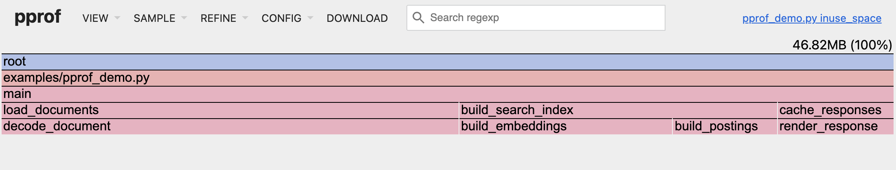

# heap-profiler

A sampling heap profiler for CPython, written in Rust. Track Python allocator
requests and selected native allocations, then explore the allocation stacks
in Go's pprof web interface.



*The pprof web UI displaying a real profile from [the included demo](examples/pprof_demo.py).
Bar widths show estimated in-use bytes. The demo retains 48 MiB of buffer payload;
allocator overhead and sampling affect the reported estimate.*

## Install

Requires **GIL-enabled CPython 3.11–3.15** and a supported 64-bit platform.

```sh
python -m pip install heap-profiler
```

The first PyPI release is being prepared. Until it is published, use the
[source build](#build-from-source) below. Installing a wheel needs no Rust
toolchain; building from source does.

## Capture a profile

```python
from pathlib import Path

import heap_profiler

heap_profiler.start_tracing()
try:
    # Run your workload. Keep its objects live to inspect retained memory.
    documents = [bytearray(1024 * 1024) for _ in range(16)]
    profile = heap_profiler.get_pprof_data(compress=True)
finally:
    heap_profiler.stop_tracing()

Path("heap.pb.gz").write_bytes(profile)
```

Capture the snapshot **before** stopping tracing. Stopping restores the original
allocators and keeps the recorded counters, but subsequent frees are no longer
reflected in those counters.

## Open it in pprof

Install [Go](https://go.dev/dl/), then run:

```sh
go tool pprof -http=127.0.0.1:8080 heap.pb.gz
```

Open <http://127.0.0.1:8080/ui/flamegraph> or select **View → Flame Graph**
to explore allocation stacks. The Graph view also
requires [Graphviz](https://graphviz.org/download/) (`dot`) on PATH. The Flame
Graph and Top views work without Graphviz.

Use the **Sample** menu to choose what to inspect:

| Metric | Meaning |
| --- | --- |
| `inuse_space` | Estimated bytes still live at the snapshot; the default view |
| `alloc_space` | Estimated cumulative bytes allocated during the interval |
| `inuse_objects` | Estimated allocator requests still live |
| `alloc_objects` | Estimated cumulative allocation requests |

For a terminal report:

```sh
go tool pprof -top -sample_index=alloc_space heap.pb.gz
```

To reproduce the screenshot's workload from a checkout:

```sh
python examples/pprof_demo.py --output heap.pb.gz
go tool pprof -http=127.0.0.1:8080 -sample_index=inuse_space heap.pb.gz
```

The demo also allocates and frees 8 MiB of temporary buffers. Compare
`alloc_space` with `inuse_space` to see that temporary work in the profile.
For an HTTP endpoint, see [examples/pprof_server.py](examples/pprof_server.py).
Its Flask dependency is optional and only needed for that example.

## Sampling and accuracy

`sample_rate` is a mean sampling interval in **bytes**, defaulting to **128 KiB**.
A larger interval captures fewer stacks and reduces overhead; a smaller one
provides more detail. Use `sample_rate=1` to record every allocation request
within the profiler's interception coverage:

```python
heap_profiler.start_tracing(sample_rate=256 * 1024)
```

The pprof export weights each sampled allocation by its inclusion probability
to estimate totals. Its matching free uses the same original weight, even if
the sampling rate changes. Small profiles and individual stacks can have
substantial sampling noise; more observations improve precision.

Reported bytes are **requested allocation sizes**, rather than process RSS,
allocator arenas, or usable block sizes. Object counts represent allocator
requests, which can differ from the number of Python objects because of
interpreter caches and free lists. Successful zero-byte requests contribute
to object counts while contributing zero requested bytes.

`get_profile_data()` exposes **raw sampled counters**, not estimated totals:

```python
for entry in heap_profiler.get_profile_data():
    sampled_live_bytes = entry.alloc_bytes - entry.free_bytes
    print(sampled_live_bytes, entry.stack_frames)
```

Each entry has `alloc_bytes`, `free_bytes`, `alloc_objects`, `free_objects`, and
`stack_frames`, whose elements are `(filename, function_name, line_number)`.
Use the pprof metrics when you need estimates of the full intercepted workload.

## How it works

heap-profiler samples allocations the same way Go's heap profiler
([`runtime.MemProfileRate`](https://pkg.go.dev/runtime#MemProfileRate)) and
TCMalloc do; TCMalloc's
[sampling design document](https://github.com/google/tcmalloc/blob/master/docs/sampling.md)
explains the method in detail.

1. **Interception.** `start_tracing()` wraps CPython's RAW, MEM, and OBJ
   allocators with `PyMem_SetAllocator`. With `native=True`, it also rebinds
   `malloc`-family imports in loaded libraries (ELF GOT on Linux, Mach-O symbol
   pointers on macOS) so allocations made by C extensions are seen too.
2. **Sampling.** Each thread keeps a byte countdown drawn from an exponential
   distribution whose mean is `sample_rate`. Every allocation subtracts its
   requested size; the allocation that reaches zero is sampled and a new
   countdown is drawn. This samples each byte with probability `1/sample_rate`
   independently of allocation boundaries, so an allocation of `s` bytes is
   sampled with probability `1 - exp(-s / sample_rate)`, and one much larger
   than the interval is almost always sampled. Unsampled allocations cost only
   the counter update.
3. **Recording.** A sampled allocation captures its Python stack, adds to the
   counters for that stack, and remembers its pointer, so the matching `free`
   or `realloc` can be credited back to the same stack.
4. **Estimation.** As in Go's profiler, each sample is weighted by the inverse
   of its inclusion probability, `1 / (1 - exp(-s / sample_rate))`, giving
   unbiased estimates of total bytes and objects. heap-profiler computes the
   weight from each allocation's own size and rate, rather than a per-stack
   average size, and its free subtracts the identical weight. Live estimates
   therefore stay consistent when sizes vary or the rate changes.
5. **Export.** `get_pprof_data()` writes those estimates as a pprof profile
   with `alloc_objects`, `alloc_space`, `inuse_objects`, and `inuse_space`
   sample types, which `go tool pprof` reads as a heap profile.

## Intervals and configuration

```python
heap_profiler.reset_profile_data()  # Start a fresh accounting interval.
heap_profiler.start_tracing(sample_rate=64 * 1024)  # Change the rate while running.
heap_profiler.stop_tracing()        # Restore allocator tables and native hooks.
```

Reset forgets allocations sampled before the reset, including those still live;
their later frees do not appear in the new interval. To profile a new workload,
reset before running it. Frees while tracing is stopped cannot update old
profiles. On Unix, forked children inherit the profile; reset in the child when
you want child-only measurements.

For Python allocator domains without native library interception:

```python
heap_profiler.start_tracing(native=False)
```

Stop tracing before changing the `native` setting. Import native extensions
before starting tracing when possible. After loading another native library,
refresh its hooks:

```python
import lzma  # Load a native standard-library extension.
heap_profiler.refresh_native_hooks()
```

`get_sample_rate()` reports the current interval in bytes. Repeated
`start_tracing()` calls also refresh native hooks. For diagnostics,
set `HEAP_PROFILER_LOG=heap_profiler=debug` to log to stderr.

## Platforms and coverage

| Platform | Architectures | Prebuilt wheels | Native interception |
| --- | --- | --- | --- |
| Linux with glibc | x86_64, ARM64 | x86_64, ARM64 (manylinux_2_28) | Eligible ELF allocator imports |
| macOS | x86_64, ARM64 | ARM64 | Eligible Mach-O allocator bindings |

On platforms without a prebuilt wheel, pip builds from source, which requires a
Rust toolchain.

Python allocator hooks cover the RAW, MEM, and OBJ domains. Native coverage
includes eligible `malloc`, `calloc`, `realloc`, and `free` calls, plus
`posix_memalign` and `aligned_alloc` where available on Unix. Custom allocator
bindings, direct function pointers obtained through `dlsym`, unresolved lazy
bindings, and memory obtained through APIs such as `mmap` are outside that
native coverage. Python hooks work independently of native interception.

On macOS, native hooks skip the dyld shared cache, authenticated pointer
sections, and chained fixups. Avoid concurrent native library unloading while
starting, stopping, or refreshing hooks. Library loading APIs are not replaced;
refresh explicitly after loading extensions.

Free-threaded CPython and subinterpreters are unsupported. Stacks contain up to
128 Python frames; detached and native threads have explicit marker frames.
Sampling does not attach a Python thread or acquire the GIL from native callbacks.

## Overhead

Overhead depends on allocation frequency, stack depth, sampling interval, and
native coverage. At the default interval, the allocation-heavy benchmarks in
[benchmarks/overhead.py](benchmarks/overhead.py) execute about 1.5× (small
allocations) and 1.7× (4 KiB allocations) the instructions of an unprofiled
run on ARM64 Linux with CPython 3.13. A compression workload dominated by
native code is unaffected. These are worst cases for allocation-bound code;
measure your application and increase the interval when throughput matters
more than sampling resolution.

CI enforces these ratios with Valgrind instruction counts, which are
deterministic, unlike wall time on shared runners. To check a change locally
on Linux with Valgrind installed:

```sh
python benchmarks/instruction_gate.py --python .venv/bin/python
```

The budget in [benchmarks/instruction_budget.json](benchmarks/instruction_budget.json)
records the architecture and exact Python version it was measured with. After
an intentional overhead change, re-record it on that setup with `--update`.
For wall-clock timings, run `benchmarks/overhead.py` with and without `--tracing`.

Profiler memory grows with distinct allocation stacks and sampled live pointers.
Reset periodically to release accumulated history. Immutable Python allocator
callback generations are retained for safety and reused across restarts; there
are 96 slots for distinct domain/allocator-table combinations.

## Build from source

Install stable Rust, uv, and Python development headers, then:

```sh
git clone https://github.com/yoava333/heap-profiler.git
cd heap-profiler
uv sync --locked
```

`uv sync` builds the extension into `.venv`. Rebuild it after Rust changes with
`uv sync --reinstall-package heap-profiler`. Run checks with:

```sh
cargo fmt --check
cargo clippy --locked --all-targets -- -D warnings
cargo test --locked
uv run ty check
uv run pytest -q tests/
```

The [dev container](.devcontainer/devcontainer.json) provides a Linux
environment with these tools and Valgrind for the instruction gate.

Release maintainers: see [the PyPI publishing setup](docs/publishing.md).

## License

[MIT](LICENSE.txt). Python bindings use [PyO3](https://pyo3.rs/); profile exports
use the [pprof format](https://github.com/google/pprof).
